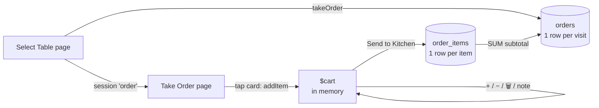
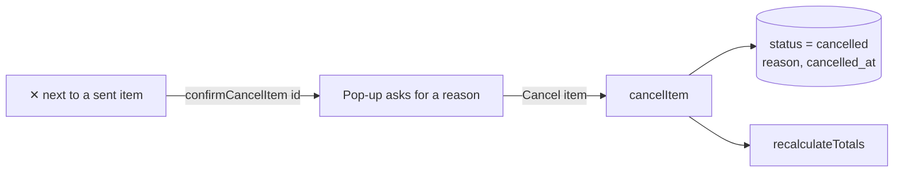

# The Take Order Page — How It Works

This document explains the **Take Order** page step by step: what the waiter does, which Livewire method runs, and what is saved in the database.

**Files involved**

| File | What it contains |
| --- | --- |
| `resources/views/pages/⚡select-table.blade.php` | Step 1: choose a table, creates the **order** |
| `resources/views/pages/⚡take-order.blade.php` | Step 2: pick menu items, the **cart**, *Send to Kitchen* |
| `app/Models/Order.php`, `app/Models/OrderItem.php` | The two tables we save into |
| `database/migrations/2026_10_07_152611_add_note_to_order_items.php` | Adds the `note` column to `order_items` |
| `database/migrations/2026_10_07_153441_add_cancel_fields_to_order_items.php` | Adds `cancel_reason` and `cancelled_at` to `order_items` |
| `tests/Feature/TakeOrderTest.php` | Automated tests for everything below |

---

## 1. The big picture



1. On **Select Table**, the waiter picks a table. `takeOrder()` creates a row in `orders` and stores the order id in the **session**.
2. On **Take Order**, every tap adds an item to the **cart** (`$cart`). Nothing is saved yet.
3. **Send to Kitchen** copies the cart into `order_items`, updates the order total, and empties the cart.
4. Guests can order again later (a second round). New items are added to the same order.

> **Why not save on every tap?** Waiters change their minds a lot ("actually, make it two"). Keeping the cart in memory until *Send to Kitchen* means the kitchen only receives the final list.

---

## 2. The two tables

**`orders`** — one row per table visit

| column | example | note |
| --- | --- | --- |
| `id` | 12 | |
| `cafe_table_id` | 3 | which table |
| `status` | `open` | `cancelled` when the whole order is cancelled |
| `subtotal` | 220.00 | sum of all its order items |
| `total_amount` | 220.00 | subtotal + tax − discount |

**`order_items`** — one row per item line

| column | example | note |
| --- | --- | --- |
| `order_id` | 12 | belongs to order 12 |
| `menu_item_id` | 5 | which menu item |
| `item_name` | Coffee | **copied** from the menu |
| `unit_price` | 50.00 | **copied** from the menu |
| `quantity` | 2 | |
| `subtotal` | 100.00 | `unit_price × quantity` |
| `note` | no sugar | kitchen instruction (new column) |
| `status` | `pending` | kitchen hasn't started it (`cancelled` when cancelled) |
| `cancel_reason` | Customer changed mind | only filled when cancelled |
| `cancelled_at` | 2026-10-07 14:05 | only filled when cancelled |

> **Question for students:** why do we copy `item_name` and `unit_price` instead of just storing `menu_item_id`?
> *Answer:* if the menu price changes tomorrow, yesterday's bills must not change.

The relationship lives in the model:

```php
// app/Models/Order.php
public function orderItems()
{
    return $this->hasMany(OrderItem::class);   // one order HAS MANY items
}
```

---

## 3. The cart (`$cart`)

The cart is a **public property**, so Livewire remembers it between clicks:

```php
public $cart = [];
```

It is an array **keyed by the menu item id**, so the same item never appears twice:

```php
[
    5 => ['name' => 'Coffee', 'price' => 50,  'qty' => 2, 'note' => 'no sugar'],
    9 => ['name' => 'Cake',   'price' => 120, 'qty' => 1, 'note' => ''],
]
```

Because the key is the id, finding an item is just `$this->cart[5]`. No loop is needed.

---

## 4. The cart methods

Each button on the page calls one method with `wire:click`.

### `addItem($menuId)`: tap on a menu card

```blade
<button type="button" wire:click="addItem({{ $menu->id }})"> ... </button>
```

```php
public function addItem($menuId){
    $menu = MenuItem::where('is_available', true)->findOrFail($menuId);

    if (isset($this->cart[$menuId])) {
        $this->cart[$menuId]['qty']++;          // already in cart → one more
    } else {
        $this->cart[$menuId] = [                // new → add a line
            'name'  => $menu->name,
            'price' => (float) $menu->price,
            'qty'   => 1,
            'note'  => '',
        ];
    }
}
```

- `isset()` checks whether the key exists in the array.
- `findOrFail()` stops with a 404 error if the item doesn't exist **or is not available**. A sold-out item can't be ordered even if someone sends its id.

### `increaseQty`, `decreaseQty`, `removeItem`: buttons in the order panel

```php
public function decreaseQty($menuId){
    if (! isset($this->cart[$menuId])) {
        return;
    }
    $this->cart[$menuId]['qty']--;

    if ($this->cart[$menuId]['qty'] < 1) {
        $this->removeItem($menuId);             // reached 0 → remove the line
    }
}

public function removeItem($menuId){
    unset($this->cart[$menuId]);                // delete one key from the array
}
```

### The kitchen note: `wire:model.blur`

```blade
<flux:input wire:model.blur="cart.{{ $menuId }}.note" />
```

- `wire:model` binds the input to a property. **Dot notation** (`cart.5.note`) reaches *inside* the array: `$cart[5]['note']`.
- `.blur` only sends the value when the input loses focus, not on every key press.

---

## 5. Computed properties (`#[Computed]`)

Totals are **calculated**, not stored. A computed property is a method that you read like a property:

```php
#[Computed]
public function cartTotal(){
    return collect($this->cart)->sum(fn ($item) => $item['price'] * $item['qty']);
}
```

```blade
₹{{ number_format($this->cartTotal, 2) }}
```

| Computed | What it returns |
| --- | --- |
| `$this->cartCount` | number of items in the cart (2 coffees + 1 cake = 3) |
| `$this->cartTotal` | price × qty of every cart line, added together |
| `$this->sentItems` | `order_items` already sent for this order (from the database) |
| `$this->orderTotal` | `sentItems` total + `cartTotal` |

Why computed and not a public property?

- It is **always correct**, because it is recalculated from the cart on every request.
- It is **not sent to the browser**, so it can't be changed by the user.
- It is calculated **once per request** and then remembered (cached) until the request ends.

> ⚠️ Because of that cache, after saving we call `unset($this->sentItems);` so the list is read again from the database.

---

## 6. `sendToKitchen()`: saving to the database

```php
public function sendToKitchen(){
    if (empty($this->cart)) {
        return;                                              // ① nothing to send
    }

    $order = Order::findOrFail($this->info['order_id']);

    $menus = MenuItem::whereIn('id', array_keys($this->cart)) // ② fresh prices
        ->get()->keyBy('id');

    DB::transaction(function () use ($order, $menus) {      // ③ all or nothing
        foreach ($this->cart as $menuId => $item) {
            $menu = $menus->get($menuId);
            $qty  = max(1, (int) $item['qty']);

            $order->orderItems()->create([                  // ④ INSERT order_items
                'menu_item_id' => $menu->id,
                'item_name'    => $menu->name,
                'unit_price'   => $menu->price,
                'quantity'     => $qty,
                'subtotal'     => $menu->price * $qty,
                'note'         => trim($item['note'] ?? '') ?: null,
                'status'       => 'pending',
            ]);
        }

        $this->recalculateTotals($order);                   // ⑤ re-calculate bill
    });

    $this->cart = [];                                        // ⑥ empty the cart
    unset($this->sentItems);
    Flux::toast(variant: 'success', heading: 'Sent to kitchen', text: '...');
}
```

| Step | Explanation |
| --- | --- |
| ① | Guard clause: stop early if there is nothing to do. |
| ② | **Security:** the cart is a public property, so a user can change `price` in the browser's developer tools. We **ignore the cart's price** and read it again from `menu_items`. `keyBy('id')` turns the list into `[5 => Coffee, 9 => Cake]` for quick lookup. |
| ③ | `DB::transaction()` makes sure that **either every insert succeeds, or none are saved**. If the 3rd insert fails, the first 2 are rolled back, so we never get half an order. |
| ④ | `$order->orderItems()->create([...])` uses the relationship, so Laravel fills in `order_id` for us. |
| ⑤ | The total is recalculated from **all** items of the order (earlier rounds + this one) using SQL `SUM()`. Cancelled items are left out (see section 8). |
| ⑥ | Empty the cart, refresh the "Sent to kitchen" list, and show a success toast. |

The equivalent SQL for one item:

```sql
INSERT INTO order_items (order_id, menu_item_id, item_name, unit_price, quantity, subtotal, note, status)
VALUES (12, 5, 'Coffee', 50.00, 2, 100.00, 'no sugar', 'pending');

UPDATE orders SET subtotal = (SELECT SUM(subtotal) FROM order_items
                              WHERE order_id = 12 AND status != 'cancelled'),
                  total_amount = ...
WHERE id = 12;
```

### Preventing double orders

```blade
<flux:button wire:click="sendToKitchen" wire:loading.attr="disabled" wire:target="sendToKitchen" ...>
```

While the request is running, the button is disabled, so a double tap can't send the same items twice.

---

## 7. What the page shows

```
┌ Current Order ─────────────── 3 new ┐
│ ✔ SENT TO KITCHEN                    │  ← $this->sentItems (database)
│   2× Coffee                 ₹100.00  │
│ ──────────────────────────────────── │
│ Cake                        ₹120.00  │  ← $cart (not saved yet)
│ [−] 1 [+]                       🗑   │
│ ✎ no nuts                            │
│ ──────────────────────────────────── │
│ Already sent                ₹100.00  │
│ New items                   ₹120.00  │
│ Order total                 ₹220.00  │  ← $this->orderTotal
│ [   ✈ Send to Kitchen   ]            │
└──────────────────────────────────────┘
```

---

## 8. Cancelling

**Rule:** only items with status `pending` (the kitchen hasn't started them) can be cancelled. Anyone can cancel them for now; later, RBAC can let managers cancel items the kitchen has already started.

### Never delete, mark as cancelled

We **don't delete** the row. We change its status and keep the reason:

```sql
UPDATE order_items
SET status = 'cancelled', cancel_reason = 'Customer changed mind', cancelled_at = NOW()
WHERE id = 31;
```

> **Question for students:** why not just `DELETE` the row?
> *Answer:* the owner needs to see what was ordered and why it was cancelled. If items could silently disappear from a bill, a dishonest employee could take the cash and delete the item.

### Recalculating the total

Every time items are sent or cancelled, one shared method recalculates the bill, **skipping cancelled items**:

```php
protected function recalculateTotals(Order $order){
    $subtotal = $order->orderItems()->where('status', '!=', 'cancelled')->sum('subtotal');
    $order->update([
        'subtotal'     => $subtotal,
        'total_amount' => $subtotal + $order->tax_amount - $order->discount_amount,
    ]);
}
```

It is `protected`, so only code **inside the class** can call it. The page can't call it with `wire:click`. Only `public` methods can be called from the browser.

### Cancel one item: two steps



```php
// Step 1 — open the pop-up (only for a pending item of THIS order)
public function confirmCancelItem($orderItemId){
    $item = OrderItem::where('order_id', $this->info['order_id'])
        ->where('status', 'pending')
        ->findOrFail($orderItemId);

    $this->cancellingItemId = $item->id;
    $this->showCancelItemModal = true;
}

// Step 2 — reason typed, "Cancel item" clicked
public function cancelItem(){
    $this->validate(['cancelReason' => 'required|string|min:3|max:100']);

    $item = OrderItem::where('order_id', $this->info['order_id'])   // check AGAIN
        ->where('status', 'pending')
        ->findOrFail($this->cancellingItemId);

    $item->update([
        'status'        => 'cancelled',
        'cancel_reason' => $this->cancelReason,
        'cancelled_at'  => now(),
    ]);

    $this->recalculateTotals($item->order);
}
```

**Why check twice?**

1. Between opening the pop-up and clicking *Cancel item*, the kitchen may have started cooking it.
2. `$cancellingItemId` is a public property, so it could be changed in the browser to the id of **another table's** item. The `where('order_id', ...)` makes sure we only touch items of *this* order.

### Cancel the whole order

The **Cancel order** button in the orange header is only shown while `$this->canCancelOrder` is true:

```php
#[Computed]
public function canCancelOrder(){
    // true when no sent item has a status other than pending / cancelled
    return $this->sentItems->whereNotIn('status', ['pending', 'cancelled'])->isEmpty();
}
```

`cancelOrder()` does four things inside **one transaction**:

1. Sets every `pending` item to `cancelled` (one `UPDATE ... WHERE order_id = ? AND status = 'pending'`).
2. Recalculates the total (now ₹0).
3. Sets the order to `status = 'cancelled'` and saves the reason in `orders.notes`.
4. Sets the table back to `status = 'available'`.

Then it removes the order from the session (`session()->forget('order')`), **flashes** a message, and redirects to *Select Table*. A flash message is kept in the session for **one** request only; *Select Table* shows it with `session('status')`.

### What the waiter sees

```
✔ SENT TO KITCHEN
  2× Coffee                 ₹100.00  ✕   ← pending: can be cancelled
  1× Cake  [Cancelled]      ₹120.00      ← struck through, not in the total
  Customer changed mind
  1× Soup  [Preparing]       ₹90.00      ← kitchen started: no ✕
```

---

## 9. Testing it

```bash
php artisan test --compact tests/Feature/TakeOrderTest.php
```

The tests check that:

- tapping adds an item, and tapping again increases the quantity
- sold-out items can't be added
- `−` down to zero removes the line, and 🗑 removes it
- *Send to Kitchen* saves the items with their note and updates the order total
- a second round is added to the same order
- a price changed in the browser is ignored
- an empty cart saves nothing
- a pending item can be cancelled with a reason, and the total goes down
- a reason is required
- items the kitchen has started, or items of another order, cannot be cancelled
- the whole order can be cancelled (items, order and table are all updated), but not once the kitchen has started
- a cancelled order can't be opened again

Remember to run the new migrations once:

```bash
php artisan migrate
```

---

## 10. Exercises for students

1. **Tax:** add 5% GST. Where would you calculate it, and which column stores it?
2. **Kitchen screen:** make a page that lists `order_items` with `status = 'pending'`, with a button that changes the status to `ready`.
3. **Discount:** let the waiter enter a discount and save it in `orders.discount_amount`.
4. **Bill / checkout:** when guests pay, set `orders.status = 'paid'`, set `paid_at = now()`, and set the table back to `available`.
5. **RBAC:** only users with a `kitchen` role may open the kitchen screen.
6. **Manager cancel:** let users with a `cancel started items` permission cancel items that are `preparing`.
7. **Cancellation report:** list all cancelled items for today, with the reason and the total value lost.
